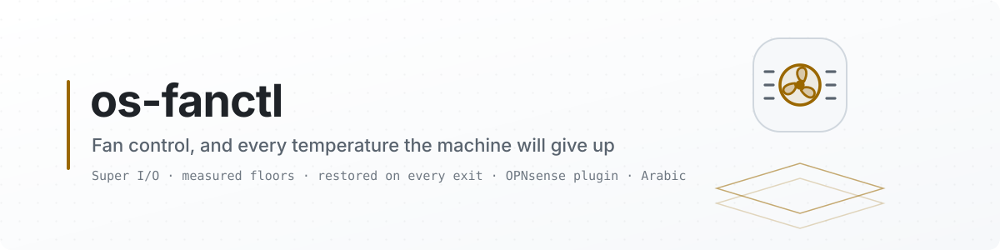

<picture>
  <source media="(prefers-color-scheme: dark)" srcset="docs/images/readme/banner-dark.svg">
  <source media="(prefers-color-scheme: light)" srcset="docs/images/readme/banner-light.svg">
  
</picture>

<p align="center">
  <a href="https://github.com/AbdelmonemAwad/os-fanctl/releases/latest"></a>
  <a href="https://github.com/AbdelmonemAwad/os-fanctl/actions/workflows/checks.yml"></a>
  <a href="LICENSE"></a>
  <a href="#fan-control-for-opnsense"></a>
  <a href="https://github.com/AbdelmonemAwad/opnsense-arabic"></a>
  <a href="https://github.com/AbdelmonemAwad/os-xgs-npu"></a>
  <br>
  <a href="#fan-control-for-opnsense"></a>
  <a href="#fan-control-for-opnsense"></a>
  <a href="#what-it-does"></a>
</p>

# Fan Control for OPNsense

A plugin that gives a repurposed appliance back the fan curve that went away with the vendor's
firmware — and that is arranged, from the bottom up, so it can never be the reason a fan stops.

I wrote it after putting a quiet fan in a decommissioned appliance and finding the machine
hotter, not quieter. The board's own SmartFan IV curve was asking the chassis fan for **20% duty
while the CPU cores sat at 80 °C** (measured here). That curve was tuned in a factory for the
high-rpm fan the box shipped with; on the fan that is in it now, 20% is almost no air at all.
Nothing in OPNsense could see that, and nothing in OPNsense could change it.

Then, while measuring what a faster fan bought, I found something worse and much simpler: the
new fan had gone in **backwards**. It was pulling the power supply's own hot exhaust back across
the board. Turning it round was worth **22 °C** — more than four times the fan speed had bought.
That is why this plugin records what it measures instead of only acting on it, and why the page
says what it has not measured rather than filling the gap with a number.

Tested on OPNsense 26.7.4_1 / FreeBSD 15.1-RELEASE-p3, on one machine: an ex-Sophos XG 330 rev 2
with a Nuvoton NCT6779D. Everything below marked **measured here** was measured on that machine.
Everything else comes from primary sources and is marked where it matters. On 2026-10-31 it runs on OPNsense 26.7.8_1 on the first XGS 3300.

<p align="center"><b>Contents:</b> <a href="#what-it-does">What it does</a> &middot; <a href="#what-it-refuses-to-do-and-why-that-is-the-point">What it refuses to do, and why that is the point</a> &middot; <a href="#the-safety-contract">The safety contract</a> &middot; <a href="#the-board-curves-return-to-the-standard-curve">The board curve's return to the standard curve</a> &middot; <a href="#two-things-worth-knowing-about-this-class-of-hardware">Two things worth knowing about this class of hardware</a> &middot; <a href="#installing-it">Installing it</a> &middot; <a href="#putting-it-on-an-appliance-it-has-never-seen">Putting it on an appliance it has never seen</a> &middot; <a href="#where-the-details-are">Where the details are</a> &middot; <a href="#in-the-xgs-image">In the XGS image</a> &middot; <a href="#in-arabic">In Arabic</a> &middot; <a href="#updates">Updates</a> &middot; <a href="#licence">Licence</a></p>

## What it does

- **Controls fans on a Super I/O chip that FreeBSD cannot control.** There is no in-tree driver,
  sysctl, ioctl or userland tool that will set a fan duty on any Super I/O on FreeBSD 15 —
  `ncthwm(4)` registers five sysctls and every one is read-only by construction. The only
  writable path is raw port I/O, so this plugin ships a small C helper that does exactly that and
  nothing else, built on the firewall by the firewall's own compiler.
- **Reads every temperature the machine will give up**, by asking the kernel which of its
  thousands of sysctl nodes are declared as temperatures rather than by carrying a list of driver
  names — so it finds the sensors on hardware nobody has ever tested it on. On the Sophos XGS
  3300 it also reads the board's own sensor bank - the CPU as the board sees it, the NPU
  (the coprocessor die, which no kernel driver reports) and the inlet air, and both fans as
  tachometers - through the small tool [os-xgs-npu](https://github.com/AbdelmonemAwad/os-xgs-npu)
  installs, which reaches the CPLD over the host's SMBus; watched, not driven, because that
  board's fan curve has no register the host can write. ~~That was the end of it~~ It has a
  choice, though (since 1.1.6, 2026-10-30): the CPLD drives both fans on the CPU's temperature -
  measured on an XGS 3300, 6,900-7,200 rpm at rest and 13,200-13,500 held for two minutes under
  full load on every host core - and it has a second, lower curve, which the vendor's own startup
  script in its GPL sources selects on the XGS 2100 and 2300 through the coprocessor's GPIO 48.
  **Board fan curve** on the Settings tab selects it on any board built on AMDA0202 - the XGS
  2100, 2300, 3100 and 3300 - while the plugin is enabled: 4,800-5,400 rpm at rest on the 3300,
  still rising with heat (8,100 after a three-second burst on every core), the coprocessor about
  5 C warmer at rest (76.5 against 70-72 C). It is set again within a minute whenever the
  coprocessor restarts - measured across a reboot: three minutes after it, when the coprocessor's
  link was up - and gives way to the standard curve while the coprocessor, its memory or a port
  PHY is too warm ([below](#the-board-curves-return-to-the-standard-curve)); a reading that
  cannot be taken changes nothing. The board's fans are read again from
  the CPLD on every refresh of the page, so its cards show the speed of that second, one card a
  fan, and the bar's top is the measured 13,500. Where the coprocessor's memory module has a
  temperature sensor, os-xgs-npu's driver holds that reading too, and it is listed as a memory
  module; so are its port chips - the switch, the SFP+ cages' PHY and an expansion module's
  PHY - listed as port PHYs. Since 2026-11-17 the page gives the memory a card and the hottest of
  the port PHYs one, each with the record's lowest, mean and highest over the window chosen, and
  the dashboard panel gives their two lines the last day's; memory modules and port PHYs are
  offered as temperatures to follow wherever a machine reports them, and never followed unless
  chosen.
- **Keeps a record**, once a minute, of every sensor and every fan: the lowest, the highest and
  the time-weighted mean over the last hour, day, week and month, and how long each sensor spent
  above each rung of a fixed ladder. One sample costs 1.4 ms and the whole record is bounded at
  503 KiB (measured here).
- **Draws it**, one bar per sensor, on a scale that ends where the processor protects itself.
- **Answers the question the record exists for**: how many degrees this chassis actually gives
  back for more fan — from before-and-after pairs around real duty changes, with a guard against
  the load having moved at the same moment. The naive correlation comes out backwards.
- **Says when the answer is smaller than the instruments.** If the effect cannot be told apart
  from the rounding on these sensors, that is what it says.
- Puts a panel on the dashboard, and runs a service that hands the fans back on every path out.

## What it refuses to do, and why that is the point

The failure mode of a fan controller is not a bad user interface. It is a stopped fan in a rack
nobody is standing next to. So:

- It **does not start when you install it**, and an upgrade does not turn control on either.
- It **does not touch a fan to find out what is there**. The probe reads and writes nothing.
- It **does not drive a channel whose floor was not measured on the machine it is running on** —
  with one narrow exception, below.
- It **does not drive a channel that reports no turning fan**, and it never calls such a channel
  *stopped*. A tachometer reading zero may be an empty header, or a fan with no tach wire, or a
  fan on a header this chip does not sample. Nothing in software can tell those apart. Four of
  the five channels on the reference appliance read zero and not one of them is a stopped fan.
- It **does not take a number typed into a web page as a measurement.** The floor on the settings
  page can only ever *raise* a measured floor, never replace one.
- **Every write is read back**, and a read-back that disagrees hands the fans to the hardware and
  stops. It does not retry: a disagreement means a write went somewhere, and the honest response
  to that is to stop writing.

**The one exception**, because it is the case that forced it: a duty of **100%** needs no measured
floor. The floor exists to stop this plugin writing a duty that stops a fan, and full output
cannot stop one — it is what the chip writes with PWM switched off, and it is above every floor
that could ever be measured. So a machine can be held at full by the daemon, which restores on
every exit path, instead of by a command somebody typed once, which does not. Manual at exactly
100 and nothing else; a curve is not admitted even if all its points are 100, because a curve is
a thing people edit.

## The safety contract

Six conditions. Nothing is written unless all six hold, and they are re-checked **before every
decision**, because four of them can stop being true while the daemon is running.

| | Condition | Why it can fail mid-run |
|---|---|---|
| 1 | the chip is the one the table describes, and it can be written to | a chip that starts answering differently is not that chip |
| 2 | the table permits control, or the owner has accepted an unmeasured entry | — |
| 3 | what each channel was under before this plugin touched it has been captured | the state file can be removed under a running daemon |
| 4 | every driven channel has a measured floor, or the mode is a fixed 100% | a measurement can be superseded by a later one that stalled |
| 5 | every driven channel reports a fan that is turning | a fan can stop |
| 6 | every temperature the decision needs is readable right now | a sensor can vanish |

And every way out ends in a restore: a clean stop, an unhandled exception, a signal, the
watchdog, a sensor going quiet, a fan stalling, a read-back disagreeing, the panic temperature,
and package removal. Where a restore itself fails, the plugin says so in four places at once and
tells you the only thing that helps: **power the appliance off and on — a warm reboot does not
necessarily clear a fan register.**

## The board curve's return to the standard curve

On a board that drives its fans itself - the AMDA0202 board of the XGS 2100, 2300, 3100 and 3300 -
**Board fan curve** chooses the quiet curve, and the plugin gives way to the board's standard one
while any reading below is at or above its hot figure, until every reading that holds it is below
its cool figure. Until 2026-11-17 the coprocessor's die was the only one.

| reading | hot | cool | where the figure comes from |
|---|---|---|---|
| coprocessor | 85 C | 78 C | its die, as the CPLD reads it. The plugin's own since 1.1.6 and not a part limit: the CN8365's is not public. |
| memory | 80 C | 75 C | the coprocessor's DDR4 module, by its own JEDEC sensor where it has one. Five degrees under the 85 C its DRAM is held to in the normal range - 95 C only with its refresh doubled, which is not known of the coprocessor's memory controller (SK hynix H5AN8G4/8G8/8G6NCJR datasheet Rev 1.4, p.12; Micron MTA16ATF1G64HZ datasheet Rev F, Table 12). The sensor's own tolerance is 1 C from 75 to 95 C and 2 C from 40 to 125 C (Renesas TSE2004GB2B0 datasheet, p.7), and how far it reads from the DRAM nobody has measured. |
| port PHYs | 95 C | 88 C | the hottest of the switch (88E6193X), the SFP+ cages' PHY (88X5113) and an expansion module's PHY - an 88X5113 too on the 4x10G module AMDA0207-0001, and not known on any other module. Ten degrees under the 88X5113's 105 C maximum junction (Marvell MV-S110852-U0 Rev C, Table 61), and five under the 100 C Linux sets as the alarm of the switch family's PHY sensor, a driver's default; the switch's own limit is not public. Nor is it settled which of the switch's registers holds its temperature: the value os-xgs-npu holds for it is read from page 6, register 28, where Linux reads that family's PHY temperature at register 27 and keeps 28 for the alarm. |

The figures are the hardware table's (`fans.json`, `board_curve`), and the settings help says them.
So far they have been measured at rest only - on the second XGS 3300, from 2026-10-27 to
2026-11-17, the memory at 45.8 to 52.6 C, the switch at 58 to 61, the SFP+ cages' PHY at 60.0 to
63.2 and the module's PHY at 49.1 to 53.3 - and not yet with the ports under load.

**A reading that cannot be taken changes nothing**, as it changed nothing while the coprocessor's
was the only one (1.1.8): it neither starts the return to the standard curve nor ends it. It is left
out until it is read again, unless it held the standard curve at the last check: then it holds it
still, until it is read again below its cool figure, or until Standard is chosen or Enabled turned
off, which ends any hold. So a failed read no longer holds the standard curve: os-xgs-npu reads the
port chips every four minutes and its driver drops a value five minutes old, so one failed read
empties their nodes for minutes, and a memory module that answers one read with an error is not
read again until the next boot. The memory and the port PHYs are read from
os-xgs-npu's driver (`dev.octep.0.temperature.memory`, `.switch`, `.sfp_phy` and `.module_phy`),
which it fills every minute and every four minutes; the coprocessor from the CPLD, as before.

## Two things worth knowing about this class of hardware

Both were found on the reference appliance and both are likely to be true of its relatives.

**The ACPI fan control is scenery.** The board declares five fans, `FAN0` through `FAN4`, with
active trip points at 40.1, 45.1, 50.1, 55.1 and 71.1 °C, all hung off thermal zone `TZ00`. That
zone returns a **hardcoded constant** — `Return (0x0BC2)`, which is 27.9 °C — because the board
has no ACPI embedded controller. Not one of those trip points can ever fire. There has never been
anything on this machine capable of reacting to heat (measured here, and read out of the DSDT).

**The mode must be written before the duty.** Writing the duty first, while the channel is still
under the chip's automatic curve, reads back the chip's own value instead of yours — measured
here, twice, inside the verify window. A channel under a curve could otherwise never be taken
over, which is every channel on any board whose firmware set one.

## Installing it

```
sh install/install.sh
```

Or from a release's package: every release since 1.1.5 carries `os-fanctl-<version>.pkg` and its
`SHA256SUMS`, built by `tools/make-package.sh` - the same builder, run by hand on a firewall,
makes it from a checkout. Read it before you add it:

```sh
pkg info -lF os-fanctl-*.pkg      # every file it will write
pkg add os-fanctl-*.pkg
```

Idempotent: re-run it after an update. Your settings are kept, and so
are the floor measurements in `/var/db/fanctl` — which matter more than either, because they are
the only numbers in this plugin that came from hardware rather than from a keyboard.

The page is at **System → Fan Control** - **XGS → Fan Control** when os-xgs-npu is installed.
The dashboard panel is under **Add widget → Fan
Control**. Nothing is controlling a fan when the installer finishes, and nothing will until you
say so on that page. Once you have, it comes back at every boot: OPNsense starts it from its own
boot sequence (`plugins_configure('bootup')`), which is where a plugin's daemons are started - the
first version left a switch in `/usr/local/etc/rc.conf.d` that nothing on an OPNsense boot reads,
measured on two appliances, and a fan controller that is not running after a reboot is the one
failure this plugin exists not to have.

## Putting it on an appliance it has never seen

The reading half works anywhere, including on a machine with no fan controller in it at all: the
temperatures, the record and the graphs all fill in, and the page says in as many words that it
cannot write. The controlling half needs somebody to stand in front of the machine once. That
process — what to measure, what the table needs, and what a confirmed line has to carry behind
it — is written down in **[docs/contributing-fans.md](docs/contributing-fans.md)**.

The hardware table is the thing that is meant to grow. The reference machine is one row in it.

## Where the details are

**[DESIGN.md](DESIGN.md)** is the contract, not a summary: what the hardware allows and what it
does not, the three layers and why the boundaries are where they are, every way out, the floor
rules, the record and its arithmetic, and a section on what is deliberately unsettled. Claims in
it are marked **V** (verified on the reference machine), **D** (documented in a primary source,
quoted) or **R** (reported). Nothing unmarked is a fact.

## In the XGS image

[xgs-image-builder](https://github.com/AbdelmonemAwad/xgs-image-builder) builds an OPNsense image
for Sophos XGS appliances with this repository in it, installed at the image's first boot. It holds
no copy of this repository: every build takes `main` as it is that day, so a change merged here is
in the next image without anything being done there. What the image calls here - `install/install.sh` and `install/enable.sh` - is checked
from that side every day, so moving or renaming one of them is caught there; keep them where they are.

## In Arabic

Every string the page and the dashboard widget show is listed in
`src/opnsense/scripts/fanctl/i18n/ui/source.json`, and its Arabic is in the one Arabic catalogue of
the whole GUI, [opnsense-arabic](https://github.com/AbdelmonemAwad/opnsense-arabic)'s `ar_SA.po`,
since 2026-10-22. ~~They are in `src/opnsense/scripts/fanctl/i18n/ui/ar_SA.json` and merged into
each installed GUI language's catalogue by the installer, at every boot (`64-fanctl-i18n`) and by a
pkg trigger~~ - that table, its merge, the boot hook and the trigger are gone, and an install removes
what an earlier one left. A string added to the page needs its Arabic in opnsense-arabic first:
`tools/check-strings.py`, run by the checks, reads that catalogue and fails when the page or the
widget gains a string that is not in `source.json` or has no Arabic there.

## Updates

An installed copy is updated to this repository's **releases** by hand: from **XGS: Updates**, its *Plugins*
tab ([os-xgs-npu](https://github.com/AbdelmonemAwad/os-xgs-npu)), or with `/usr/local/opnsense/scripts/fanctl/self-update.py`.
Nothing is installed on its own since 2026-10-20: an update runs when the appliance's owner starts it. It reads the
latest release's signed manifest and, when the release is ahead of what is installed, downloads the archive the
manifest names and runs the `install/install.sh` it carries - the same script a hand install runs. A change merged
on `main` reaches installed firewalls when it is released, not before; with no release published, nothing changes.

- **Signed releases** (since 2026-11-07). A release is installed only as its owner signed it. It carries
  `os-fanctl-<tag>.tar.gz`, the tag's tree made by `git archive`; `release.json`, the manifest - the tag, its
  commit and date, the archive's SHA-256 and size; and `release.json.sig`, the manifest's Ed25519 signature, made by
  the owner's private signing repository, never by this repository's CI. The public keys are installed in
  `/usr/local/opnsense/scripts/fanctl/release-keys/`. A release whose signature does not verify with one of them,
  or whose archive is not the one signed, is not installed, and a release not signed is not offered. GitHub's API
  and npuforge.org's copy of it no longer choose what is installed, and the tag's commit is confirmed with GitHub
  before the download. A release is made a draft by `release.yml` and published only once it is signed.
- **Only forward.** What is installed is recorded in `/usr/local/share/os-fanctl/installed.json` by
  the installer - the commit, from a git checkout or from the `.source-commit` stamp that an
  xgs-image-builder image or an update leaves in the tree. A firewall running something newer than
  the release - by the date signed - is not taken back; an install from before the stamp existed takes the latest release
  once.
- **What happened** is in the system log as `self-update`, in
  `/usr/local/share/os-fanctl/update.json`, and the installer's output in `update.log` beside it.
- `/usr/local/opnsense/scripts/fanctl/self-update.py check` says what it would do and changes nothing.
- An update leaves a running controller on the code it started with, as a hand install does;
  it takes the new code at its next start.

Tested by `tools/test-self-update.py`, which the checks run - releases made and signed in the test with
throwaway keys: what is taken and refused, and what an update installs - and on an XGS 3300 through the
*Plugins* tab, with seven other plugins: [the plugins' signed releases, measured](https://github.com/AbdelmonemAwad/os-xgs-npu/blob/main/docs/measurements/signed-plugin-releases-2026-11-07.md).

## Licence

BSD 2-Clause. Copyright (C) 2026 Abdelmonem Awad.
